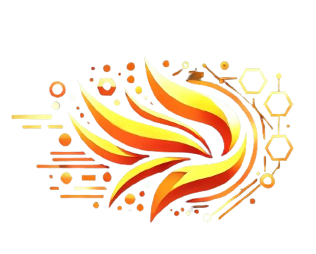

<h1 align="center">Hey, I am Barba 👋</h1>

Senior Smart Contract & Security Engineer · Cross-chain DeFi · Chainlink Developer Expert

I'm a smart contract and security engineer from Brazil. I build cross-chain DeFi infrastructure, then try to break it and prove it with invariants.

| | |
|---|---|
| Current role | Solidity Developer (Team Lead) at a DeFi R&D firm |
| Contribution | #1 committer on the protocol's main codebases, 120+ pull requests |
| Peer review | ~90 pull requests reviewed |
| Tech designs | 15+ as sole or primary author |
| Audit record | 5+ external audits on code I wrote or reviewed, zero High or Critical findings |
| Invariant fuzzing | Led the protocol-wide program, including cross-chain state |

---

## How I work

These principles shape everything below.

- Design before code. I write the design document first, with its invariants and failure modes, and sync it back once the code settles.
- Remove before handling. I ask "can we remove this?" before "how do we handle this?", because deleting a feature removes a whole class of edge cases.
- Tests that can fail. A test only counts if removing its premise breaks it, and expected values never come from the code under test.
- The right layer for each claim. Unit tests guard single calls, integration tests cross real boundaries, and invariants cover state that builds up over many calls.
- No defensive code without a known attack vector, since every line I add is one more line an auditor has to read.
- AI assists, I decide. Agents review and attack my code, but every finding is checked against the source and nothing ships without my sign-off.

---

## Stack

- Solidity, Foundry, BTT with bulloak, upgradeability, transient storage
- Hyperlane, Chainlink CCIP, CCT, Functions, Automation, VRF, Data Feeds and CRE, xERC20 / ERC-7802
- Echidna, Medusa, Recon / Chimera, Halmos, Slither, Aderyn
- Rust, Go, TypeScript, Python, Shell
- Claude Code, multi-agent pipelines, MCP servers

---

## Experience

### Solidity Developer (Team Lead), DeFi R&D firm

*Aug 2025 to present · remote*

I lead a team building the next-generation, multi-chain protocol of a major DEX ecosystem, owning components from design document to production code.

- Built the cross-chain layer, hub-and-spoke messaging over Hyperlane, and the protocol's xERC20 / ERC-7802 token.
- Built the emissions system, from rate control and global caps to reward splitting and redemptions.
- Wrote the command modules of a Universal-Router-style router and cut its bytecode by 41% to fit under EIP-170.
- Designed the multi-chain deployment system around deterministic CREATE3 addresses and resumable broadcasts.
- Wrote 15+ technical designs whose format, with invariant lists and failure-mode analyses, became the team's reference.

### Blockchain Developer, cross-chain bridging protocol

*May to Aug 2024 · remote*

I was on the core team of a protocol that delivered cross-chain USDC transfers in under 20 seconds, with Chainlink Functions confirming each transfer and liquidity pools fronting the funds while CCIP settled.

- Built the liquidity pools from scratch, a parent pool on Base with child pools on every other chain, along with the cross-chain deposit and withdrawal flows between them.
- Worked across the rest of the codebase, from the orchestrator and bridge contracts to the JavaScript running inside Chainlink Functions.
- Brought security practices and testing into the project, and my pool code passed two external audits with no High or Critical findings.

### Solidity developer and co-author, MyTrevo

*Jun to Aug 2023*

My first Solidity project, started three weeks after I learned the language, became a live cross-chain raffle protocol.

- Built all of its base logic, covering raffle creation with soft caps, ticket sales in multiple stablecoins, refunds and settlement.
- Integrated Chainlink VRF for the draw, and CCIP weeks after its launch so raffles on Polygon could pay prizes on Ethereum.

---

## Security work

I treat security as part of engineering rather than a final review, so it starts at the design document and continues well after the code ships.

- Reviewing designs for broken assumptions, trust boundaries and failure modes before any code exists.
- Building invariant fuzzing campaigns end to end, from property specs to handlers and CI, including cross-chain state.
- Measuring test strength with mutation testing and controlled experiments, not coverage alone.
- Triaging audit findings with a failing proof of concept before any fix.
- Competing in public audit contests, with a working Foundry proof of concept behind every submission.

---

## Pipelines and environments I've built

Most of what I build on my own makes security work repeatable.

### Incident response for Web3 protocols

An automated incident-response system for Web3 protocols. Consensus-based monitoring watches declarative invariants after transactions land and trips scoped circuit breakers through a Guardian contract, leaving unpause to humans. It rests on a study of 59 incidents worth $6.57B, where 93% of the losses played out over multiple blocks or hours, long enough for a two-minute breaker to reach about two thirds of the loss. The trade-off is that the first malicious transaction always lands.

### AI-assisted audit pipeline

A multi-agent pipeline for manual smart contract review, running in an isolated environment where untrusted code has no host access. I benchmark it on past audit contests, including Ammplify, the contest Pashov's solidity-auditor publishes its results on. In a single pass it found 10 of 13 Highs, twice what Pashov's v3 found, and with a targeted depth pass it matched their three-pass v4 at 11 of 13 Highs and 23 of 36 findings overall. Across three more contests it found 25 of 33 judged findings. Pashov's numbers come from their own adjudication and mine from my own, so the comparison is close rather than exact.

### Code review with AI agents

Every change I write goes through four read-only review agents in parallel, and every High they report is checked against the source before I act on it. Agents never commit, push or post, which is slower than letting them act but keeps me accountable for what ships.

### Smaller tools

- A vulnerability-pattern knowledge base in Rust, served over MCP.
- A Claude Code plugin that scaffolds a Foundry invariant suite from a design document, runs it and triages the failures.
- A Foundry dev environment template with BTT-structured unit, integration and invariant tests, CI for coverage, linting and Slither, git hooks, and a Claude Code setup with reviewer and test-writer agents, guardrails and workflow skills.

---

## Teaching and community

I learned by teaching, and I'm a Chainlink Developer Expert.

- A three-level Solidity curriculum in Portuguese, from introduction to advanced Foundry.
- A Chainlink course across five products, with deliberately flawed contracts for students to fix.
- A security workshop on the OWASP Smart Contract Top 10, with exploit-then-fix exercises.
- Workshops, translations and technical support for the Chainlink community.

---

## Learning path

Self-taught, no CS degree.

- 2023: Solidity, a first live protocol, Cyfrin Foundry Fundamentals.
- 2024: Cyfrin Advanced Foundry, the Chainlink Bootcamp, Rust basics, smart contract hacking.
- 2025: Advanced smart contract hacking, ZK with Noir, invariant fuzzing with Recon and Chimera.
- 2026: Chainlink CRE and Go.

---

## Languages

- 🇧🇷 Brazilian Portuguese (native)
- 🇺🇸 English (professional)

---

## Hackathon achievements

I also submitted InvestorHub and NebulaQuest to Chainlink Chromion in 2025.

  <table align="center">
    <tr>
      <td align="center">
        
         
        <b>🏅 Chainlink Constellation 2023</b>
         
        Top Quality winner
         
        <a href="https://devpost.com/software/horizon-8qkbv0">View project</a>
      </td>
      <td align="center">
        
         
        <b>🏅 Chainlink Block Magic 2024</b>
         
        Top Quality winner
         
        <a href="https://devpost.com/software/trident-d2lakz">View project</a>
      </td>
      <td align="center">
        
         
        <b>🏆 Blockchain Rio Hack 2024</b>
         
        1st place
         
        <a href="https://taikai.network/blockchainrio/hackathons/blockchainriohack24/results">View project</a>
      </td>
    </tr>
  </table>

